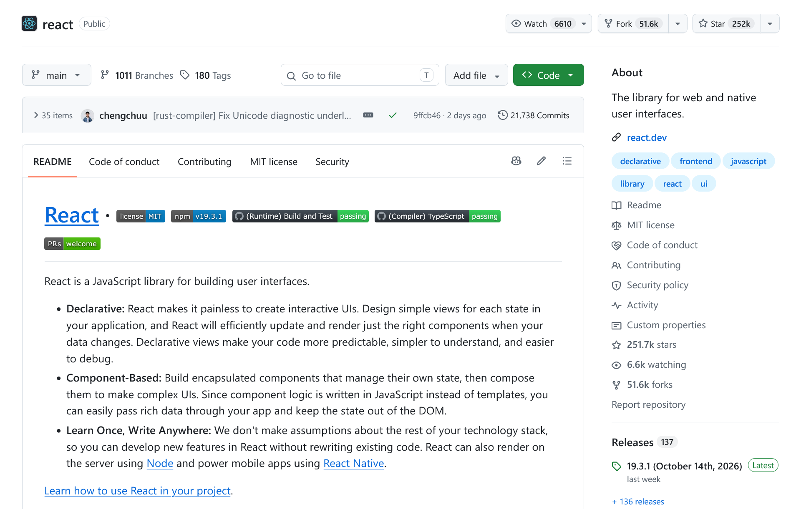

# GitHub : fold the file list on repo root

A Tampermonkey userscript that folds the file listing on a repository's root page by default, 
so the README moves up. A fold icon in the latest-commit bar unfolds it again.

## Install

**[Install with Tampermonkey](https://raw.githubusercontent.com/churchilldu/github-repo-root-fold/main/github-repo-root-fold.user.js)** —
one click; Tampermonkey opens its install prompt.

1. Install [Tampermonkey](https://www.tampermonkey.net/) if you have not.
2. Click [`github-repo-root-fold.user.js`](https://raw.githubusercontent.com/churchilldu/github-repo-root-fold/main/github-repo-root-fold.user.js).
